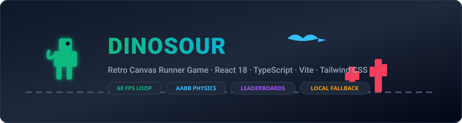
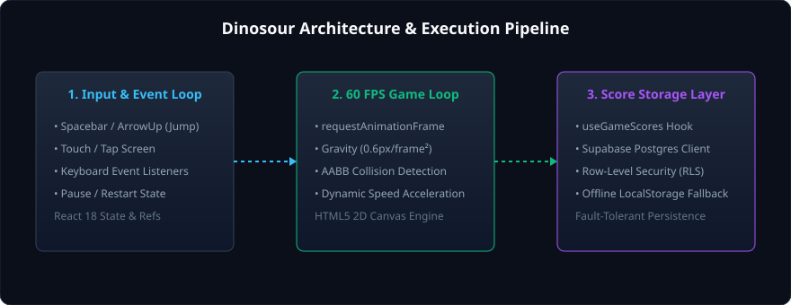

<div align="center">



# Dinosour

**A high-performance, retro browser runner game engineered with React 18, TypeScript, HTML5 Canvas, Vite, and Tailwind CSS.**

[](https://github.com/kamalesh404/dinosour/actions/workflows/ci.yml)
[](https://www.typescriptlang.org/)
[](https://react.dev/)
[](https://vitejs.dev/)
[](https://tailwindcss.com/)
[](LICENSE)

[🎮 Play Live Demo](https://kamalesh404.github.io/dinosour/) · [Report Bug](https://github.com/kamalesh404/dinosour/issues) · [Request Feature](https://github.com/kamalesh404/dinosour/issues)

</div>

---

## 📖 Overview

**Dinosour** is a modern browser arcade runner inspired by classic offline mini-games. Built from the ground up using React 18, HTML5 2D Canvas rendering, and TypeScript, it features deterministic frame-rate physics, Axis-Aligned Bounding Box (AABB) collision detection, dynamic difficulty scaling, and a dual-tier persistence system that seamlessly falls back to `localStorage` when cloud services are unavailable.

---

## ✨ Features

- **⚡ 60 FPS Canvas Game Loop:** High-performance hardware-accelerated 2D canvas rendering with sub-pixel interpolation.
- **🎯 Precise AABB Collision Detection:** Accurate bounding-box calculations for both ground obstacles (single & double cacti) and aerial threats (pterodactyls).
- **📈 Dynamic Difficulty Curve:** Obstacle spawn frequency and horizontal scrolling velocity scale progressively as score increments.
- **🏆 Dual-Mode Score Leaderboard:** Integrates with Supabase Postgres for global leaderboards with automated fallback to `localStorage` for offline gameplay.
- **📱 Fully Responsive & Touch-Ready:** Seamless control via physical keyboards (Space / Up Arrow) or mobile touch taps.
- **🛡️ Clean Code & Type Safety:** Fully typed TypeScript architecture with ESLint 9 configuration and automated GitHub Actions verification.

---

## 🕹️ Controls

| Action | Keyboard | Touch / Mobile |
|---|---|---|
| **Jump** | `Spacebar` or `Arrow Up` | Tap Canvas |
| **Start / Restart** | `Spacebar` or Click "Play Now" | Tap "Play Again" button |
| **View Leaderboard** | Click "Leaderboard" Trophy Icon | Tap Trophy Icon |

---

## 🏗️ Architecture

```
dinosour/
├── .github/workflows/
│   └── ci.yml               # Automated CI (lint, typecheck, build) & GitHub Pages deploy
├── docs/assets/             # Project architectural diagrams and graphics
├── public/                  # Static assets and game favicon
├── src/
│   ├── components/
│   │   └── DinoGame.tsx     # Primary Canvas render loop, state machine & UI overlay
│   ├── hooks/
│   │   └── useGameScores.ts # Dual-tier score hook (Supabase API + LocalStorage fallback)
│   ├── lib/
│   │   └── supabase.ts      # Safe Supabase client factory with runtime null guard
│   ├── App.tsx              # Application root
│   ├── main.tsx             # DOM mounting point
│   └── index.css            # Tailwind CSS directives
├── supabase/migrations/     # PostgreSQL schema for cloud leaderboard table
├── index.html               # Single-page entry with modern viewport meta
├── package.json             # Pinned scripts and dependencies
├── tailwind.config.js       # Utility styling configuration
└── vite.config.ts           # Production build configuration with Pages base path
```

<div align="center">
  
</div>

---

## 🚀 Quick Start

### Prerequisites
- **Node.js**: v18.x or higher (tested on Node.js v24.x)
- **npm**: v9.x or higher

### Installation

1. **Clone the repository:**
   ```bash
   git clone -b main1 https://github.com/kamalesh404/dinosour.git
   cd dinosour
   ```

2. **Install dependencies:**
   ```bash
   npm install
   ```

3. **Configure Environment (Optional):**
   Copy the example environment file if you wish to connect a live Supabase database for global leaderboards:
   ```bash
   cp .env.example .env
   ```
   > *Note:* If no `.env` is configured, Dinosour operates out-of-the-box using browser `localStorage` for all scores.

4. **Start the local development server:**
   ```bash
   npm run dev
   ```
   Open your browser at `http://localhost:5173/dinosour/`.

---

## 🛠️ Verification & Build Commands

| Command | Description |
|---|---|
| `npm run dev` | Starts Vite HMR local development server |
| `npm run typecheck` | Validates TypeScript types across the entire project |
| `npm run lint` | Runs ESLint to verify style and hook rules |
| `npm run build` | Compiles optimized production bundle into `dist/` |
| `npm run preview` | Locally serves production build for inspection |

---

## ☁️ Deployment

Dinosour includes an automated GitHub Actions deployment workflow at [`.github/workflows/ci.yml`](.github/workflows/ci.yml). 

Whenever commits are pushed to the `main1` branch:
1. Automated CI validates formatting, ESLint rules, and TypeScript types.
2. The production bundle is compiled via `vite build`.
3. The build output in `dist/` is deployed automatically to GitHub Pages.

---

## 📄 License

This project is licensed under the [MIT License](LICENSE).
